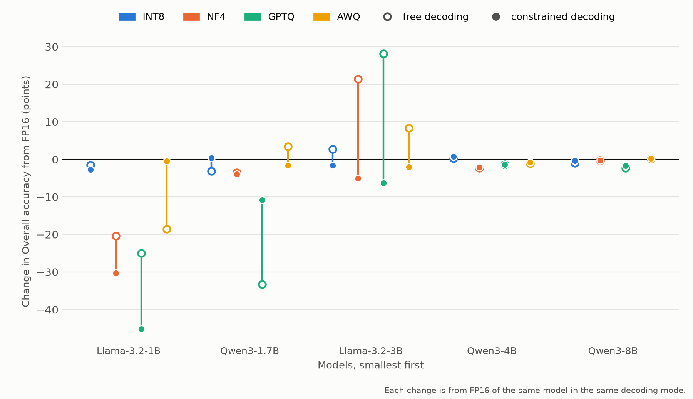
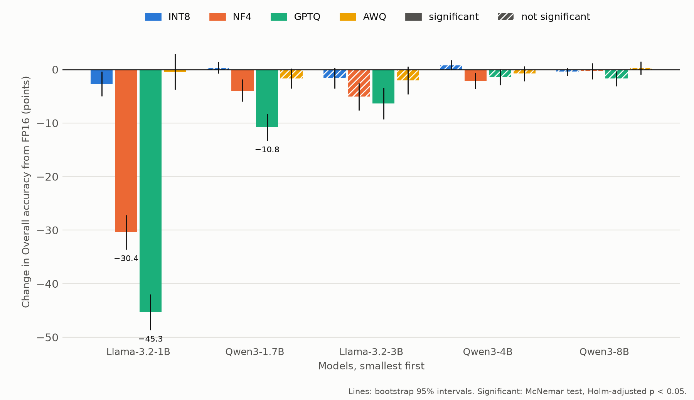
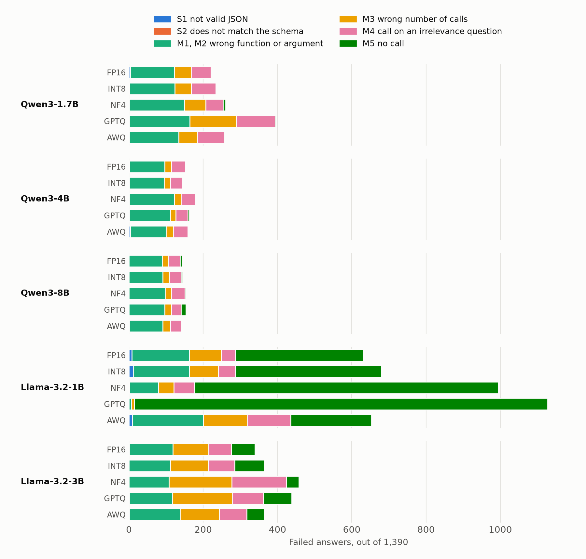

# How Much of the Quantization Penalty Does Constrained Decoding Remove? (Update 10)

**Goal:** answer RQ3. For each model and precision, compare the change from FP16 with free decoding (Updates 4-8)
and with JSON-schema-constrained decoding (Update 9), and find which failures are left.

## Method

- **Code:** [`src/gap.py`](../src/gap.py) writes [`gap.csv`](gap.csv) and [`transitions.csv`](transitions.csv);
  `src/significance.py --mode constrained` writes [`significance_constrained.csv`](significance_constrained.csv);
  `src/taxonomy.py --mode constrained` writes [`taxonomy_constrained.csv`](taxonomy_constrained.csv). The figures
  are drawn by [`src/figures.py`](../src/figures.py).
- **Penalty:** a quantized run's change in Overall from FP16 of the same model, in the same decoding mode. So each
  mode is compared with its own FP16 baseline.
- **Difference** = constrained change - free change, in points. Above 0, the constraint makes the loss smaller (or
  the gain larger). Its 95% interval is a bootstrap: 10,000 resamples of the questions, drawn inside each category,
  with the same questions for all four runs (seed 42). The 20 intervals are not corrected for multiple comparisons.
- **Loss removed** = difference / size of the free loss, only for the 7 losses that were significant with free
  decoding (Update 8). 100% = the loss is gone, 0% = unchanged, below 0% = the loss is larger, above 100% = it
  turned into a gain.
- **Transitions:** for each run, on the 1,150 AST questions, what happens under the constraint to the answers that
  failed on format with free decoding (S1 or S2 in Update 7's classes), and how many right answers become wrong.
- **Significance under the constraint:** the same test as Update 8 (McNemar's exact test with Holm's correction
  over 20 tests), on the constrained runs.

## Result: the 7 significant losses

| Model | Precision | Free change | Constrained change | Difference [95% interval] | Loss removed |
|---|---|---:|---:|---|---:|
| Qwen3-1.7B | INT8 | -3.14 | +0.33 | +3.47 [+1.71, +5.23] | 111% |
| Qwen3-1.7B | GPTQ | -33.31 | -10.81 | +22.50 [+19.69, +25.37] | 68% |
| Llama-3.2-1B-Instruct | AWQ | -18.59 | -0.44 | +18.15 [+14.10, +22.17] | 98% |
| Qwen3-4B | NF4 | -2.35 | -2.13 | +0.22 [-0.35, +0.83] | 9% |
| Qwen3-8B | GPTQ | -2.31 | -1.70 | +0.61 [-0.08, +1.35] | 26% |
| Llama-3.2-1B-Instruct | NF4 | -20.38 | -30.36 | -9.98 [-13.46, -6.48] | -49% |
| Llama-3.2-1B-Instruct | GPTQ | -25.00 | -45.29 | -20.29 [-23.65, -17.04] | -81% |

**The constraint removes a loss only when the loss is a format error over the right content.** Three outcomes:

1. **Removed (3 losses).** Qwen3-1.7B INT8 and GPTQ and Llama-3.2-1B AWQ. With free decoding, Qwen3-1.7B GPTQ
   failed on format on 414 AST questions; under the constraint, 279 of them are right. What is left of its loss
   (-10.81, still significant) is content: 134 of the 414 become wrong-content failures, mostly the wrong number
   of calls. Llama-3.2-1B AWQ failed on format on 756 AST questions, and 374 of them are right under the
   constraint.
2. **Unchanged (2 losses).** Qwen3-4B NF4 and Qwen3-8B GPTQ. These small losses were already about content (wrong
   argument values, Update 7), which a schema cannot fix. Both intervals of the difference include 0, so the
   percentages (9% and 26%) are not reliable.
3. **Larger (2 losses).** Llama-3.2-1B NF4 and GPTQ. Their free losses were mostly format too, but under the
   constraint the model answers with an empty array (no call) instead. Of NF4's 545 format failures, 113 become
   right and 337 become "no call"; of GPTQ's 788, 20 become right and 754 become "no call". The constraint also
   breaks answers that were right with free decoding: 157 (NF4) and 143 (GPTQ), of which 150 and 143 become
   "no call".

So "mostly format" is not enough. The loss goes away only if the quantized model still writes the right call once
the format is forced.

**Gains disappear too.** With free decoding, Llama-3.2-3B gained 8.35 to 28.14 points with NF4, GPTQ and AWQ, and
Qwen3-1.7B gained 3.38 with AWQ. Under the constraint all four are below FP16 (-1.65 to -6.33; significant only for Llama-3.2-3B GPTQ). These gains came
from FP16 failing more often on format (Llama-3.2-3B FP16 left out the closing `]`). The constraint fixes FP16's
format as well: 583 of Llama-3.2-3B FP16's 746 format failures become right, and its Overall rises by 39.66 points,
so the quantized runs no longer look better.

## All 20 runs

| Model | Precision | Free change | Constrained change | Difference [95% interval] | Constrained: right at FP16 only | Constrained: right quantized only | Constrained p (Holm) |
|---|---|---:|---:|---|---:|---:|---:|
| Qwen3-1.7B | INT8 | -3.14 | +0.33 | +3.47 [+1.71, +5.23] | 14 | 13 | 1.000 |
| Qwen3-1.7B | NF4 | -3.50 | -3.96 | -0.46 [-2.77, +1.85] | 74 | 28 | < 0.001 |
| Qwen3-1.7B | GPTQ | -33.31 | -10.81 | +22.50 [+19.69, +25.37] | 150 | 27 | < 0.001 |
| Qwen3-1.7B | AWQ | +3.38 | -1.65 | -5.03 [-6.92, -3.15] | 49 | 31 | 0.567 |
| Qwen3-4B | INT8 | +0.25 | +0.79 | +0.54 [-0.48, +1.58] | 6 | 10 | 1.000 |
| Qwen3-4B | NF4 | -2.35 | -2.13 | +0.22 [-0.35, +0.83] | 40 | 15 | 0.014 |
| Qwen3-4B | GPTQ | -1.44 | -1.40 | +0.04 [-0.52, +0.58] | 31 | 17 | 0.567 |
| Qwen3-4B | AWQ | -1.06 | -0.77 | +0.29 [-0.17, +0.83] | 21 | 17 | 1.000 |
| Qwen3-8B | INT8 | -1.02 | -0.37 | +0.65 [-0.21, +1.52] | 8 | 5 | 1.000 |
| Qwen3-8B | NF4 | -0.29 | -0.31 | -0.02 [-0.77, +0.73] | 24 | 20 | 1.000 |
| Qwen3-8B | GPTQ | -2.31 | -1.70 | +0.61 [-0.08, +1.35] | 30 | 14 | 0.249 |
| Qwen3-8B | AWQ | +0.13 | +0.25 | +0.12 [-0.04, +0.42] | 18 | 18 | 1.000 |
| Llama-3.2-1B-Instruct | INT8 | -1.46 | -2.69 | -1.23 [-4.08, +1.69] | 100 | 60 | 0.025 |
| Llama-3.2-1B-Instruct | NF4 | -20.38 | -30.36 | -9.98 [-13.46, -6.48] | 393 | 47 | < 0.001 |
| Llama-3.2-1B-Instruct | GPTQ | -25.00 | -45.29 | -20.29 [-23.65, -17.04] | 538 | 5 | < 0.001 |
| Llama-3.2-1B-Instruct | AWQ | -18.59 | -0.44 | +18.15 [+14.10, +22.17] | 120 | 178 | 0.014 |
| Llama-3.2-3B-Instruct | INT8 | +2.64 | -1.62 | -4.26 [-7.15, -1.48] | 43 | 28 | 0.767 |
| Llama-3.2-3B-Instruct | NF4 | +21.37 | -5.08 | -26.45 [-30.46, -22.54] | 89 | 56 | 0.092 |
| Llama-3.2-3B-Instruct | GPTQ | +28.14 | -6.33 | -34.47 [-38.96, -29.81] | 137 | 61 | < 0.001 |
| Llama-3.2-3B-Instruct | AWQ | +8.35 | -2.06 | -10.41 [-14.37, -6.52] | 73 | 60 | 1.000 |

- **Under the constraint, 8 of the 20 changes are significant** (free decoding: 11). Seven are clear losses: Qwen3-1.7B
  NF4 and GPTQ, Qwen3-4B NF4, Llama-3.2-1B INT8, NF4 and GPTQ, and Llama-3.2-3B GPTQ. The eighth, Llama-3.2-1B AWQ,
  is explained below. The two larger Qwen3 models
  again stay within 2.13 points of FP16.
- **Llama-3.2-1B AWQ is significant although its change is -0.44.** It gets 178 AST questions right that FP16 gets
  wrong, and 120 the other way round, so it is right more often. But its gains are in the simple categories (Python,
  Java, JavaScript), which together make up only a quarter of Overall, and it loses in multiple, parallel and
  parallel-multiple, which make up the other three quarters. McNemar's test counts every question equally; Overall
  does not.
- **Llama-3.2-3B NF4's interval leaves out zero, but it is not significant after Holm** (p = 0.092), as for
  Qwen3-1.7B NF4 in Update 8.
- The figure below has the constrained changes alone, in the style of Update 8.

## Which failures remain

| Failures in all 25 runs | S1 | S2 | M1 | M2 | M3 | M4 | M5 | Total | Syntactic |
|---|---:|---:|---:|---:|---:|---:|---:|---:|---:|
| Free (Update 7) | 3,620 | 3,224 | 34 | 2,098 | 614 | 927 | 1,108 | 11,625 | 58.9% |
| Constrained | 53 | 0 | 65 | 2,773 | 1,464 | 1,372 | 3,228 | 8,955 | 0.6% |

S1 not valid JSON, S2 does not match the schema, M1 wrong function, M2 wrong argument value, M3 wrong number of
calls, M4 a call on an irrelevance question, M5 no call. Counts per run: [`taxonomy_constrained.csv`](taxonomy_constrained.csv).

- **Syntactic failures are almost gone:** none breaks the schema, and the 53 that do not parse were cut off at
  4,096 tokens or stopped early (Update 9).
- **Semantic failures nearly double**, from 4,781 to 8,902. Many answers that broke the format with free decoding
  also had wrong content; the constraint fixes the format and shows the content error.
- **What is left depends on the model.** Qwen3 models fail mostly on argument values (M2: 49% to 64% of their
  failures). Llama-3.2-1B mostly makes no call (M5: 71%). Llama-3.2-3B is spread over the wrong number of calls
  (32%), wrong values (29%), calls on irrelevance questions (22%) and no call (15%).
- **More calls on irrelevance questions** (M4, 927 to 1,372): with free decoding, 576 irrelevance answers did not
  parse and counted as correct (no call). Under the constraint almost every answer parses, so an unwanted call is
  now a valid call and counts as a failure. Irrelevance accuracy is in
  [`main_table_constrained.md`](main_table_constrained.md).

## Notes

- **The schema allows an empty array.** Irrelevance questions need it (the right answer is no call), and the
  schema does not know which questions are irrelevance questions. So a model can always escape to `[]`, and
  Llama-3.2-1B NF4 and GPTQ do. Forbidding `[]` on AST questions would tell the model the question type, so it was
  not done.
- **One run per configuration.** Decoding is greedy, so the intervals and tests cover the choice of questions, not
  run-to-run noise.
- **Overall leaves out irrelevance,** so the penalties and differences are about the 1,150 AST questions only.
