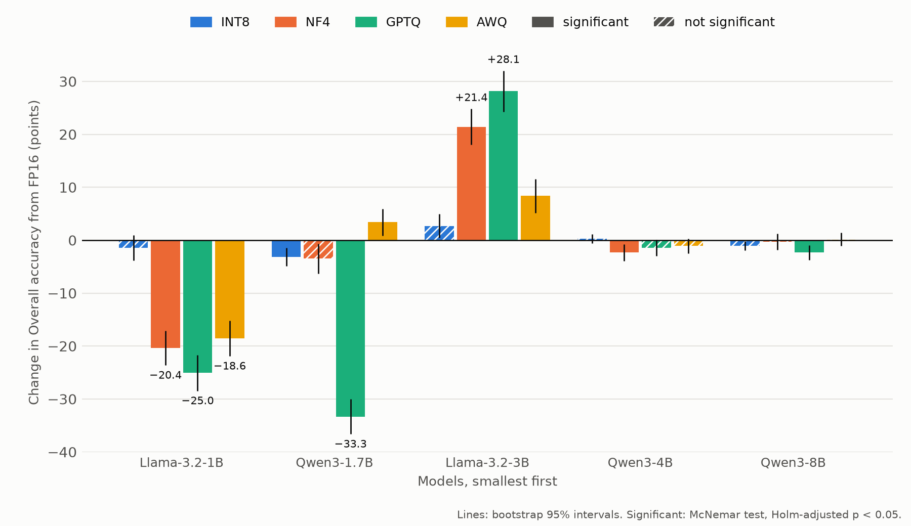

# Is Each Change Real? Significance Tests, Free Decoding (Update 8)

**Goal:** for each of the 20 quantized runs, test whether its change in accuracy from FP16 is more than chance,
and give a range for its size.

## Method

- **Code:** [`src/significance.py`](../src/significance.py) reads `results/scores/` and writes
  [`significance_free.csv`](significance_free.csv). The figure is drawn by [`src/figures.py`](../src/figures.py).
- **Paired by question.** Each quantized run answered the same 1,390 questions as the FP16 run of the same model,
  with the same prompts. Only the 1,150 AST questions are used, because Overall leaves out irrelevance.
- **Is the change real?** McNemar's exact test. It looks only at the questions that one run got right and the
  other got wrong ("Right at FP16 only" and "Right quantized only" below). If quantization changed nothing, both
  numbers would be about the same.
- **Many tests at once.** With 20 tests, some would pass by luck. Holm's correction raises the p values to allow
  for this. A change counts as **significant** when its Holm-adjusted p is below 0.05.
- **How large is it?** A bootstrap 95% interval for the change in Overall: 10,000 resamples of the questions,
  drawn inside each category (seed 42), with Overall computed the same way as BFCL's score.
- **Change** is the difference of the two Overall values in [`main_table.md`](main_table.md), so it matches that
  table.

## Results

| Model | Precision | Change (points) | 95% interval | Right at FP16 only | Right quantized only | p | p (Holm) | Significant |
|---|---|---:|---|---:|---:|---:|---:|---|
| Qwen3-1.7B | INT8 | -3.14 | [-4.88, -1.44] | 49 | 24 | 0.005 | 0.046 | yes |
| Qwen3-1.7B | NF4 | -3.50 | [-6.29, -0.69] | 107 | 79 | 0.047 | 0.380 | no |
| Qwen3-1.7B | GPTQ | -33.31 | [-36.65, -30.04] | 342 | 44 | < 0.001 | < 0.001 | yes |
| Qwen3-1.7B | AWQ | +3.38 | [+0.83, +5.90] | 54 | 97 | < 0.001 | 0.007 | yes |
| Qwen3-4B | INT8 | +0.25 | [-0.60, +1.12] | 7 | 9 | 0.804 | 1.000 | no |
| Qwen3-4B | NF4 | -2.35 | [-3.92, -0.81] | 43 | 15 | < 0.001 | 0.004 | yes |
| Qwen3-4B | GPTQ | -1.44 | [-2.98, +0.04] | 35 | 19 | 0.040 | 0.362 | no |
| Qwen3-4B | AWQ | -1.06 | [-2.48, +0.29] | 24 | 16 | 0.268 | 1.000 | no |
| Qwen3-8B | INT8 | -1.02 | [-1.94, -0.17] | 14 | 5 | 0.064 | 0.445 | no |
| Qwen3-8B | NF4 | -0.29 | [-1.81, +1.19] | 23 | 20 | 0.761 | 1.000 | no |
| Qwen3-8B | GPTQ | -2.31 | [-3.71, -0.96] | 32 | 12 | 0.004 | 0.040 | yes |
| Qwen3-8B | AWQ | +0.13 | [-1.10, +1.40] | 19 | 18 | 1.000 | 1.000 | no |
| Llama-3.2-1B-Instruct | INT8 | -1.46 | [-3.88, +0.94] | 82 | 83 | 1.000 | 1.000 | no |
| Llama-3.2-1B-Instruct | NF4 | -20.38 | [-23.65, -17.15] | 250 | 75 | < 0.001 | < 0.001 | yes |
| Llama-3.2-1B-Instruct | GPTQ | -25.00 | [-28.48, -21.69] | 327 | 45 | < 0.001 | < 0.001 | yes |
| Llama-3.2-1B-Instruct | AWQ | -18.59 | [-21.92, -15.25] | 257 | 109 | < 0.001 | < 0.001 | yes |
| Llama-3.2-3B-Instruct | INT8 | +2.64 | [+0.48, +4.92] | 60 | 81 | 0.092 | 0.551 | no |
| Llama-3.2-3B-Instruct | NF4 | +21.37 | [+18.04, +24.81] | 39 | 346 | < 0.001 | < 0.001 | yes |
| Llama-3.2-3B-Instruct | GPTQ | +28.14 | [+24.29, +32.00] | 63 | 459 | < 0.001 | < 0.001 | yes |
| Llama-3.2-3B-Instruct | AWQ | +8.35 | [+5.17, +11.52] | 66 | 200 | < 0.001 | < 0.001 | yes |

## Notes

- **11 of the 20 changes are significant.**
- **Qwen3-4B and Qwen3-8B:** only two changes are significant, Qwen3-4B NF4 (-2.35) and Qwen3-8B GPTQ (-2.31).
  All eight intervals stay within 4 points of zero.
- **Qwen3-1.7B:** GPTQ (-33.31) is a real drop, and AWQ (+3.38) is a real gain. INT8 (-3.14) is only just
  significant (p = 0.046 after Holm). NF4 (-3.50) is not, although its drop is larger: NF4 changes many answers
  both ways (107 lost, 79 gained, against 49 and 24 for INT8), so the same net change is less certain.
- **Llama-3.2-1B** drops with NF4, GPTQ and AWQ (18.59 to 25.00 points), and **Llama-3.2-3B** gains with all
  three (8.35 to 28.14 points). INT8 is not significant for either.
- **An interval that leaves out zero is not the same as "significant" here.** The intervals are not corrected for
  20 tests, and Overall weights the categories while McNemar's test counts every AST question equally. So
  Qwen3-1.7B NF4, Qwen3-8B INT8 and Llama-3.2-3B INT8 have intervals that leave out zero, but are not significant
  after Holm. The test decides; the interval shows the size.
- **One run per configuration.** Decoding is greedy, so a second run could differ only through small GPU rounding
  differences; these were not measured. The tests cover the choice of questions, not run-to-run noise.
