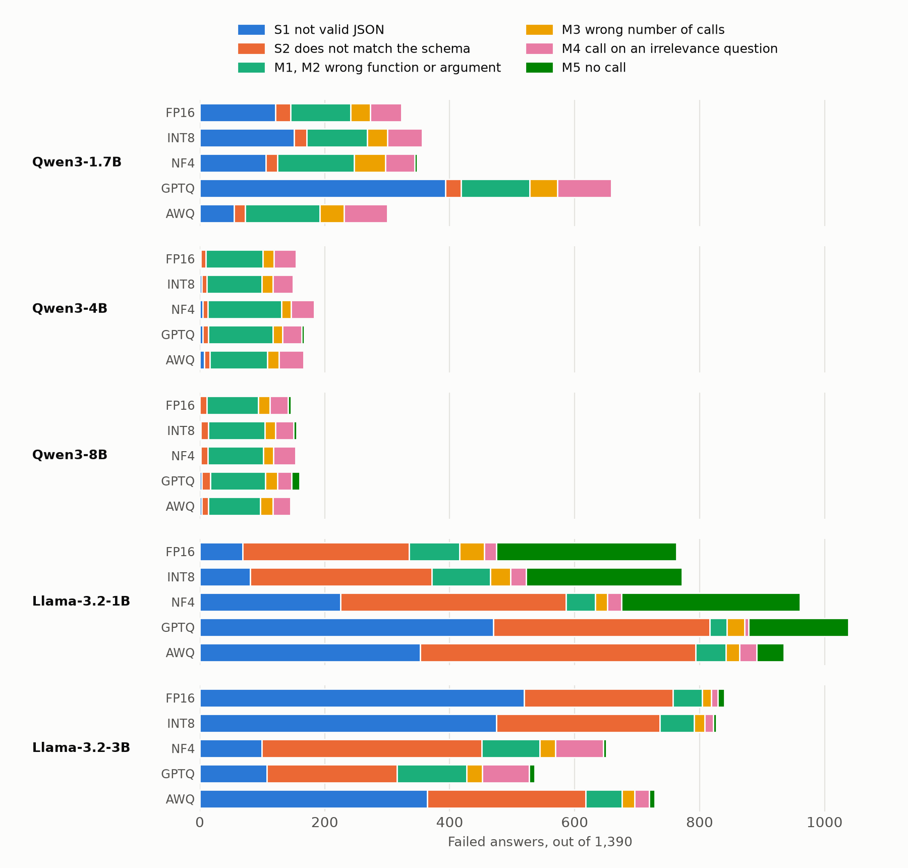

# Failure Classes, Free Decoding (Update 7)

**Goal:** sort every failed answer of the 25 free runs into a class, to see which failures are about format
(syntactic) and which are about content (semantic).

## How an answer is classified

- **Code:** [`src/taxonomy.py`](../src/taxonomy.py) reads `results/raw/` and `results/scores/` and writes
  [`taxonomy_free.csv`](taxonomy_free.csv) (one row per run and category). The figure is drawn by
  [`src/figures.py`](../src/figures.py).
- **Schema:** the one in [`src/schema.py`](../src/schema.py), which constrained decoding enforces (Update 9).
  So the syntactic classes are exactly the failures that constrained decoding can block.
- **Syntactic** (the answer is not well formed):
  - **S1** not valid JSON
  - **S2** valid JSON that does not match the schema: wrong keys (for example a copied function definition, or
    `parameters` in place of `arguments`), a function name that is not in the list, an extra or missing argument,
    a wrong type (for example `"4"` for `4`), or a value outside an enum
- **Semantic** (the answer matches the schema, but BFCL's checker rejects it):
  - **M1** wrong function (one from the list)
  - **M2** wrong argument value
  - **M3** wrong number of calls
  - **M4** a call on an irrelevance question
  - **M5** no call (an empty array) when one was needed
- The checks run in this order, so an answer with a format error is syntactic even if its content is also wrong.
- An irrelevance answer that does not parse makes no call, so BFCL counts it as correct. These 576 answers (in all
  25 runs) are counted as correct.
- The classifier was checked by hand on 80 random failures and agreed on all 80 in its final version
  ([`notes/taxonomy_check.md`](../notes/taxonomy_check.md)).

## Failures per run

Counts out of 1,390 answers (1,150 AST questions and 240 irrelevance questions). "Correct" is BFCL's verdict.
Overall accuracy in [`main_table.md`](main_table.md) is a mean over categories, so it does not follow these
counts exactly.

| Model | Precision | Correct | S1 | S2 | M1 | M2 | M3 | M4 | M5 | Syntactic share of failures |
|---|---|---:|---:|---:|---:|---:|---:|---:|---:|---:|
| Qwen3-1.7B | FP16 | 1,066 | 121 | 24 | 1 | 95 | 32 | 50 | 1 | 44.8% |
| Qwen3-1.7B | INT8 | 1,034 | 151 | 20 | 2 | 95 | 32 | 56 | 0 | 48.0% |
| Qwen3-1.7B | NF4 | 1,042 | 106 | 18 | 3 | 120 | 50 | 47 | 4 | 35.6% |
| Qwen3-1.7B | GPTQ | 730 | 393 | 25 | 1 | 109 | 44 | 87 | 1 | 63.3% |
| Qwen3-1.7B | AWQ | 1,089 | 55 | 18 | 5 | 114 | 39 | 69 | 1 | 24.3% |
| Qwen3-4B | FP16 | 1,235 | 2 | 8 | 0 | 91 | 18 | 35 | 1 | 6.5% |
| Qwen3-4B | INT8 | 1,240 | 3 | 8 | 0 | 88 | 18 | 32 | 1 | 7.3% |
| Qwen3-4B | NF4 | 1,206 | 5 | 8 | 1 | 117 | 15 | 37 | 1 | 7.1% |
| Qwen3-4B | GPTQ | 1,223 | 5 | 9 | 1 | 102 | 15 | 31 | 4 | 8.4% |
| Qwen3-4B | AWQ | 1,223 | 7 | 9 | 0 | 92 | 19 | 39 | 1 | 9.6% |
| Qwen3-8B | FP16 | 1,244 | 0 | 11 | 0 | 83 | 18 | 29 | 5 | 7.5% |
| Qwen3-8B | INT8 | 1,235 | 2 | 12 | 1 | 89 | 17 | 29 | 5 | 9.0% |
| Qwen3-8B | NF4 | 1,235 | 2 | 11 | 1 | 88 | 16 | 35 | 2 | 8.4% |
| Qwen3-8B | GPTQ | 1,230 | 3 | 14 | 0 | 88 | 19 | 23 | 13 | 10.6% |
| Qwen3-8B | AWQ | 1,244 | 3 | 11 | 1 | 82 | 20 | 28 | 1 | 9.6% |
| Llama-3.2-1B-Instruct | FP16 | 627 | 69 | 266 | 2 | 79 | 39 | 20 | 288 | 43.9% |
| Llama-3.2-1B-Instruct | INT8 | 618 | 81 | 290 | 3 | 91 | 32 | 25 | 250 | 48.1% |
| Llama-3.2-1B-Instruct | NF4 | 429 | 225 | 361 | 1 | 46 | 19 | 23 | 286 | 61.0% |
| Llama-3.2-1B-Instruct | GPTQ | 352 | 470 | 346 | 0 | 28 | 28 | 6 | 160 | 78.6% |
| Llama-3.2-1B-Instruct | AWQ | 455 | 353 | 441 | 2 | 46 | 22 | 27 | 44 | 84.9% |
| Llama-3.2-3B-Instruct | FP16 | 550 | 519 | 238 | 1 | 46 | 15 | 10 | 11 | 90.1% |
| Llama-3.2-3B-Instruct | INT8 | 563 | 475 | 261 | 2 | 53 | 17 | 14 | 5 | 89.0% |
| Llama-3.2-3B-Instruct | NF4 | 739 | 99 | 352 | 2 | 91 | 25 | 77 | 5 | 69.3% |
| Llama-3.2-3B-Instruct | GPTQ | 854 | 107 | 209 | 1 | 110 | 25 | 75 | 9 | 59.0% |
| Llama-3.2-3B-Instruct | AWQ | 662 | 364 | 254 | 3 | 55 | 20 | 23 | 9 | 84.9% |

## Change from FP16

More (+) or fewer (-) failed answers than the same model in FP16.

| Model | Precision | Syntactic (S1, S2) | Semantic (M1-M5) | All failures |
|---|---|---:|---:|---:|
| Qwen3-1.7B | INT8 | +26 | +6 | +32 |
| Qwen3-1.7B | NF4 | -21 | +45 | +24 |
| Qwen3-1.7B | GPTQ | +273 | +63 | +336 |
| Qwen3-1.7B | AWQ | -72 | +49 | -23 |
| Qwen3-4B | INT8 | +1 | -6 | -5 |
| Qwen3-4B | NF4 | +3 | +26 | +29 |
| Qwen3-4B | GPTQ | +4 | +8 | +12 |
| Qwen3-4B | AWQ | +6 | +6 | +12 |
| Qwen3-8B | INT8 | +3 | +6 | +9 |
| Qwen3-8B | NF4 | +2 | +7 | +9 |
| Qwen3-8B | GPTQ | +6 | +8 | +14 |
| Qwen3-8B | AWQ | +3 | -3 | +0 |
| Llama-3.2-1B-Instruct | INT8 | +36 | -27 | +9 |
| Llama-3.2-1B-Instruct | NF4 | +251 | -53 | +198 |
| Llama-3.2-1B-Instruct | GPTQ | +481 | -206 | +275 |
| Llama-3.2-1B-Instruct | AWQ | +459 | -287 | +172 |
| Llama-3.2-3B-Instruct | INT8 | -21 | +8 | -13 |
| Llama-3.2-3B-Instruct | NF4 | -306 | +117 | -189 |
| Llama-3.2-3B-Instruct | GPTQ | -441 | +137 | -304 |
| Llama-3.2-3B-Instruct | AWQ | -139 | +27 | -112 |

## Notes

- **Over all 25 runs,** 6,844 of the 11,625 failures (58.9%) are syntactic.
- **Qwen3-4B and Qwen3-8B** have at most 17 syntactic failures per run. Their failures are mostly wrong argument
  values (M2), at every precision, and quantization changes their failure counts by at most 29.
- **In the three smaller models, quantization mostly moves the syntactic counts.**
  - Qwen3-1.7B GPTQ has 273 more syntactic failures than FP16 and 63 more semantic ones. Most of its drop is
    format, as Update 6 found.
  - Llama-3.2-1B with NF4, GPTQ and AWQ has 251 to 481 more syntactic failures. With GPTQ and AWQ it also
    gives fewer empty answers: M5 falls from 288 (FP16) to 160 and 44, but many of the new answers are
    broken. Of its 1,704 S2 failures, 811 have wrong keys. In 413 of them the first wrong call copies the
    function definition, and in 327 it writes `parameters` in place of `arguments`.
  - Llama-3.2-3B with NF4 and GPTQ has 306 and 441 fewer syntactic failures. Its S1 failures fall from 519
    (FP16) to 99 and 107. In FP16, 503 of the 519 would parse if a closing `]` were added. Most of its S2
    failures put a number, a list or `true`/`false` in quotes (for example `"4"` for `4`).
- **The two counts are not independent.** An answer with a format error is never checked for content. So when
  fewer answers break, more are checked for content, and some of those are wrong. A rise in semantic failures
  next to a larger fall in syntactic ones (Llama-3.2-3B NF4 and GPTQ) does not by itself mean worse content.
- **M1 is rare** (34 in all 25 runs). An answer that names a function that is not in the list breaks the schema,
  so it is S2 (258 answers). M1 counts only a listed function used in the wrong place.
- **The schema is very slightly stricter than BFCL's checker:** 14 of the 34,750 answers are correct by BFCL but
  do not match the schema. In 13 of them, BFCL's answer key accepts a value that the function definition does
  not allow: a string where it asks for an array (9 answers, all to `parallel_multiple_21`), an empty string
  for an enum (3) and words in a list of integers (1). The 14th writes `"> "` for `">"`, and BFCL's checker
  ignores the space. Constrained decoding would block all 14 of these correct answers.
- These are single runs, not yet tested for significance (Update 8).
